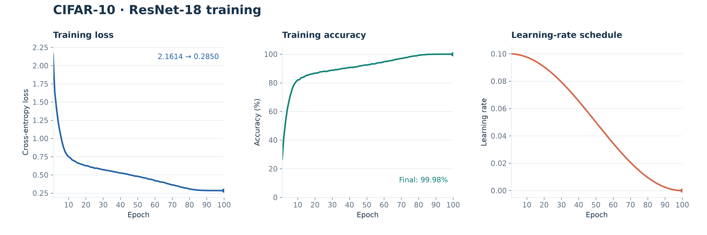
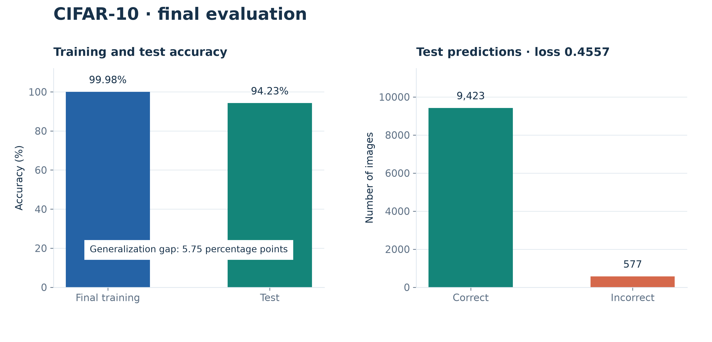

# CIFAR-10 图像分类实验

## 1. 实验任务

本实验实现一个使用卷积神经网络识别 CIFAR-10 图像的完整程序。数据目录按类别分为 `train/` 与 `test/`，程序通过 `torchvision.datasets.ImageFolder` 读取图片；运行前需自行解压数据包并将数据目录放在默认位置，或通过 `--data-root` 指定位置。按作业数据说明，训练集应有 50000 张、测试集有 10000 张。

所有图像为 32×32 RGB 彩色图片，共 10 类。输入张量按 CIFAR-10 常用通道统计量归一化：均值为 (0.4914, 0.4822, 0.4465)，标准差为 (0.2470, 0.2435, 0.2616)。训练集执行随机裁剪（先补 4 像素，再裁回 32×32）和随机水平翻转；这些增强只用于训练，测试时保持原图。

## 2. 网络结构

模型采用适配 32×32 输入的 ResNet-18。网络开头为 3×3 卷积、批归一化和 ReLU，不使用 ImageNet ResNet 常见的大步幅卷积或最大池化，以保留小图像的空间细节。主体由四个残差阶段组成，每阶段包含两个 BasicBlock，通道数依次为 64、128、256、512；后面三个阶段的首个残差块以步幅 2 下采样。每个 BasicBlock 使用两层 3×3 卷积、批归一化和 ReLU，并通过恒等映射或 1×1 投影捷径连接输入与输出。残差连接有助于梯度传播，使较深网络更容易训练。

末端采用自适应全局平均池化，将空间特征汇总为 512 维向量，再用全连接层映射到 10 个类别的 logits。训练时使用交叉熵损失，并启用 0.05 的 label smoothing，模型输出未经 softmax 的 logits。

| 阶段 | 主要结构 | 输出尺寸 |
| --- | --- | --- |
| 输入与卷积入口 | RGB 输入 → 3×3 Conv → BN → ReLU | 64×32×32 |
| 残差阶段 1 | 2 个 BasicBlock，64 通道 | 64×32×32 |
| 残差阶段 2 | 2 个 BasicBlock，128 通道 | 128×16×16 |
| 残差阶段 3 | 2 个 BasicBlock，256 通道 | 256×8×8 |
| 残差阶段 4 | 2 个 BasicBlock，512 通道 | 512×4×4 |
| 分类头 | 全局平均池化 → 512→10 全连接 | 10 |

## 3. 安装与运行

以下命令在 `Assignment_3/NeuralNetworks/` 中执行。使用 Python 3.12 及以上且受所安装 PyTorch 版本支持的环境，并在虚拟环境中安装依赖：

```bash
# 创建并激活虚拟环境
python3 -m venv .venv
source .venv/bin/activate

# 安装必要的包
pip install -r requirements.txt

# 完整训练
python3 train.py

# 训练结束后，重新测试已保存的模型
python3 train.py --eval-only
```

运行前将数据压缩包解压，使数据目录包含 `train/` 和 `test/` 两个子目录，每个子目录下再按类别分别存放图像。默认优先读取本目录的 `CIFAR10/train/`、`CIFAR10/test/`。自定义位置可用 `--data-root /path/to/CIFAR10` 指定。

默认训练 100 个 epoch，batch size 为 128，优化器为带 Nesterov 动量的 SGD，初始学习率 0.1、动量 0.9、权重衰减 5×10⁻⁴。学习率使用余弦退火逐步衰减。随机种子默认设为 42。可通过 `--epochs`、`--batch-size`、`--workers`、`--lr`、`--data-root` 和 `--output` 修改参数。若有 CUDA GPU，程序使用自动混合精度并将数据固定到显存传输；没有 GPU 时自动在 CPU 上运行。

测试集只在训练结束后评估一次，不参与梯度计算或参数选择。模型每轮保存到 `checkpoints/resnet18_cifar10.pt`。完整训练结束后，终端显示测试损失与准确率，并写入同目录的 `resnet18_cifar10.results.json`。

## 4. 测试结果

本次在 CUDA 设备上按程序默认配置训练结束时训练准确率为 99.98%。最终在全部 10000 张测试图像上评估，测试交叉熵损失为 0.4557，Top-1 准确率为 **94.23%**。

| 指标 | 结果 |
| --- | ---: |
| 运行设备 | CUDA |
| 训练轮数 | 100 |
| 训练图像数 | 49995 |
| 测试图像数 | 10000 |
| 最终训练准确率 | 99.98% |
| 测试损失 | 0.4557 |
| 测试准确率 | **94.23%** |

训练集准确率明显高于测试集，说明模型对训练样本拟合充分，同时仍有泛化差距。随机裁剪、水平翻转、权重衰减和标签平滑对控制过拟合有帮助。

### 4.1 结果可视化

下图根据第 5 节记录的 100 轮日志绘制训练损失、训练准确率和学习率曲线。测试集只在训练结束后评估，因此没有逐轮测试曲线。



最终训练准确率与测试准确率相差 **5.75 个百分点**。按测试集的 10000 张图片和 94.23% 准确率计算，正确分类 9423 张、错误分类 577 张。



## 5. CLI 输出

```bash
Device: cuda
Dataset: 49995 train, 10000 test | ['airplane', 'automobile', 'bird', 'cat', 'deer', 'dog', 'frog', 'horse', 'ship', 'truck']

Epoch 001/100 | train loss 2.1614 | train accuracy 26.50% | lr 0.099975
Epoch 002/100 | train loss 1.6396 | train accuracy 42.68% | lr 0.099901
Epoch 003/100 | train loss 1.4158 | train accuracy 53.06% | lr 0.099778
Epoch 004/100 | train loss 1.2262 | train accuracy 61.63% | lr 0.099606
Epoch 005/100 | train loss 1.0905 | train accuracy 67.54% | lr 0.099384
Epoch 006/100 | train loss 0.9762 | train accuracy 72.38% | lr 0.099114
Epoch 007/100 | train loss 0.8822 | train accuracy 76.33% | lr 0.098796
Epoch 008/100 | train loss 0.8174 | train accuracy 79.06% | lr 0.098429
Epoch 009/100 | train loss 0.7764 | train accuracy 80.72% | lr 0.098015
Epoch 010/100 | train loss 0.7487 | train accuracy 82.03% | lr 0.097553
Epoch 011/100 | train loss 0.7342 | train accuracy 82.15% | lr 0.097044
Epoch 012/100 | train loss 0.7073 | train accuracy 83.59% | lr 0.096489
Epoch 013/100 | train loss 0.6949 | train accuracy 83.78% | lr 0.095888
Epoch 014/100 | train loss 0.6840 | train accuracy 84.37% | lr 0.095241
Epoch 015/100 | train loss 0.6647 | train accuracy 85.14% | lr 0.09455
Epoch 016/100 | train loss 0.6584 | train accuracy 85.39% | lr 0.093815
Epoch 017/100 | train loss 0.6484 | train accuracy 85.86% | lr 0.093037
Epoch 018/100 | train loss 0.6434 | train accuracy 86.09% | lr 0.092216
Epoch 019/100 | train loss 0.6308 | train accuracy 86.47% | lr 0.091354
Epoch 020/100 | train loss 0.6267 | train accuracy 86.71% | lr 0.090451
Epoch 021/100 | train loss 0.6235 | train accuracy 86.77% | lr 0.089508
Epoch 022/100 | train loss 0.6156 | train accuracy 87.11% | lr 0.088526
Epoch 023/100 | train loss 0.6034 | train accuracy 87.65% | lr 0.087506
Epoch 024/100 | train loss 0.6041 | train accuracy 87.69% | lr 0.086448
Epoch 025/100 | train loss 0.5917 | train accuracy 88.05% | lr 0.085355
Epoch 026/100 | train loss 0.5929 | train accuracy 87.91% | lr 0.084227
Epoch 027/100 | train loss 0.5884 | train accuracy 88.00% | lr 0.083066
Epoch 028/100 | train loss 0.5815 | train accuracy 88.44% | lr 0.081871
Epoch 029/100 | train loss 0.5770 | train accuracy 88.59% | lr 0.080645
Epoch 030/100 | train loss 0.5712 | train accuracy 88.83% | lr 0.079389
Epoch 031/100 | train loss 0.5685 | train accuracy 88.80% | lr 0.078104
Epoch 032/100 | train loss 0.5606 | train accuracy 89.31% | lr 0.076791
Epoch 033/100 | train loss 0.5604 | train accuracy 89.12% | lr 0.075452
Epoch 034/100 | train loss 0.5536 | train accuracy 89.50% | lr 0.074088
Epoch 035/100 | train loss 0.5504 | train accuracy 89.73% | lr 0.0727
Epoch 036/100 | train loss 0.5450 | train accuracy 90.03% | lr 0.071289
Epoch 037/100 | train loss 0.5385 | train accuracy 90.06% | lr 0.069857
Epoch 038/100 | train loss 0.5365 | train accuracy 90.26% | lr 0.068406
Epoch 039/100 | train loss 0.5291 | train accuracy 90.47% | lr 0.066937
Epoch 040/100 | train loss 0.5264 | train accuracy 90.73% | lr 0.065451
Epoch 041/100 | train loss 0.5227 | train accuracy 90.74% | lr 0.06395
Epoch 042/100 | train loss 0.5186 | train accuracy 90.76% | lr 0.062434
Epoch 043/100 | train loss 0.5143 | train accuracy 91.08% | lr 0.060907
Epoch 044/100 | train loss 0.5103 | train accuracy 91.12% | lr 0.059369
Epoch 045/100 | train loss 0.5026 | train accuracy 91.46% | lr 0.057822
Epoch 046/100 | train loss 0.4975 | train accuracy 91.80% | lr 0.056267
Epoch 047/100 | train loss 0.4945 | train accuracy 91.88% | lr 0.054705
Epoch 048/100 | train loss 0.4848 | train accuracy 92.23% | lr 0.05314
Epoch 049/100 | train loss 0.4831 | train accuracy 92.36% | lr 0.051571
Epoch 050/100 | train loss 0.4797 | train accuracy 92.42% | lr 0.05
Epoch 051/100 | train loss 0.4745 | train accuracy 92.65% | lr 0.048429
Epoch 052/100 | train loss 0.4699 | train accuracy 92.80% | lr 0.04686
Epoch 053/100 | train loss 0.4621 | train accuracy 93.25% | lr 0.045295
Epoch 054/100 | train loss 0.4588 | train accuracy 93.19% | lr 0.043733
Epoch 055/100 | train loss 0.4548 | train accuracy 93.32% | lr 0.042178
Epoch 056/100 | train loss 0.4437 | train accuracy 93.83% | lr 0.040631
Epoch 057/100 | train loss 0.4411 | train accuracy 94.03% | lr 0.039093
Epoch 058/100 | train loss 0.4382 | train accuracy 94.06% | lr 0.037566
Epoch 059/100 | train loss 0.4301 | train accuracy 94.31% | lr 0.03605
Epoch 060/100 | train loss 0.4218 | train accuracy 94.76% | lr 0.034549
Epoch 061/100 | train loss 0.4157 | train accuracy 94.94% | lr 0.033063
Epoch 062/100 | train loss 0.4139 | train accuracy 94.97% | lr 0.031594
Epoch 063/100 | train loss 0.4022 | train accuracy 95.38% | lr 0.030143
Epoch 064/100 | train loss 0.4016 | train accuracy 95.46% | lr 0.028711
Epoch 065/100 | train loss 0.3977 | train accuracy 95.68% | lr 0.0273
Epoch 066/100 | train loss 0.3902 | train accuracy 96.11% | lr 0.025912
Epoch 067/100 | train loss 0.3813 | train accuracy 96.32% | lr 0.024548
Epoch 068/100 | train loss 0.3755 | train accuracy 96.55% | lr 0.023209
Epoch 069/100 | train loss 0.3685 | train accuracy 96.83% | lr 0.021896
Epoch 070/100 | train loss 0.3620 | train accuracy 97.04% | lr 0.020611
Epoch 071/100 | train loss 0.3605 | train accuracy 97.12% | lr 0.019355
Epoch 072/100 | train loss 0.3510 | train accuracy 97.53% | lr 0.018129
Epoch 073/100 | train loss 0.3477 | train accuracy 97.61% | lr 0.016934
Epoch 074/100 | train loss 0.3416 | train accuracy 97.90% | lr 0.015773
Epoch 075/100 | train loss 0.3312 | train accuracy 98.31% | lr 0.014645
Epoch 076/100 | train loss 0.3293 | train accuracy 98.40% | lr 0.013552
Epoch 077/100 | train loss 0.3211 | train accuracy 98.67% | lr 0.012494
Epoch 078/100 | train loss 0.3184 | train accuracy 98.78% | lr 0.011474
Epoch 079/100 | train loss 0.3154 | train accuracy 98.86% | lr 0.010492
Epoch 080/100 | train loss 0.3054 | train accuracy 99.28% | lr 0.0095492
Epoch 081/100 | train loss 0.3035 | train accuracy 99.31% | lr 0.008646
Epoch 082/100 | train loss 0.2982 | train accuracy 99.55% | lr 0.0077836
Epoch 083/100 | train loss 0.2967 | train accuracy 99.58% | lr 0.0069629
Epoch 084/100 | train loss 0.2933 | train accuracy 99.71% | lr 0.0061847
Epoch 085/100 | train loss 0.2910 | train accuracy 99.80% | lr 0.0054497
Epoch 086/100 | train loss 0.2895 | train accuracy 99.87% | lr 0.0047586
Epoch 087/100 | train loss 0.2883 | train accuracy 99.89% | lr 0.0041123
Epoch 088/100 | train loss 0.2873 | train accuracy 99.92% | lr 0.0035112
Epoch 089/100 | train loss 0.2865 | train accuracy 99.94% | lr 0.002956
Epoch 090/100 | train loss 0.2862 | train accuracy 99.95% | lr 0.0024472
Epoch 091/100 | train loss 0.2858 | train accuracy 99.96% | lr 0.0019853
Epoch 092/100 | train loss 0.2853 | train accuracy 99.97% | lr 0.0015708
Epoch 093/100 | train loss 0.2853 | train accuracy 99.96% | lr 0.0012042
Epoch 094/100 | train loss 0.2853 | train accuracy 99.97% | lr 0.00088564
Epoch 095/100 | train loss 0.2851 | train accuracy 99.97% | lr 0.00061558
Epoch 096/100 | train loss 0.2849 | train accuracy 99.98% | lr 0.00039426
Epoch 097/100 | train loss 0.2850 | train accuracy 99.97% | lr 0.0002219
Epoch 098/100 | train loss 0.2850 | train accuracy 99.98% | lr 9.8664e-05
Epoch 099/100 | train loss 0.2849 | train accuracy 99.97% | lr 2.4672e-05
Epoch 100/100 | train loss 0.2850 | train accuracy 99.98% | lr 0
Test loss: 0.4557 | Test accuracy: 94.23%
Test results saved to /output/ML2027/Assignment_3/NeuralNetworks/checkpoints/resnet18_cifar10.results.json
```
