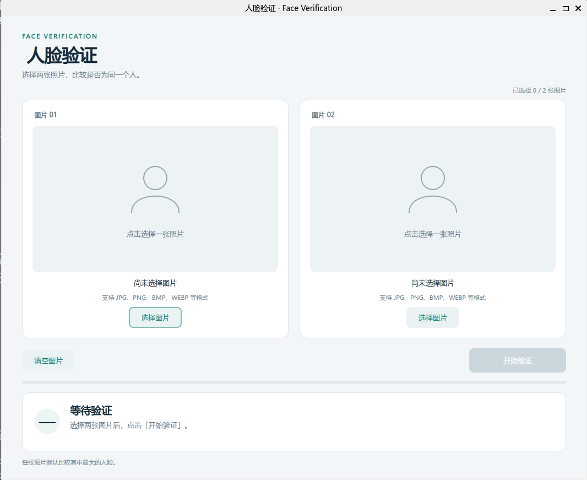
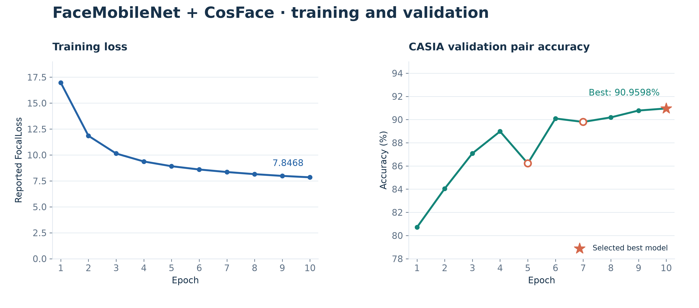
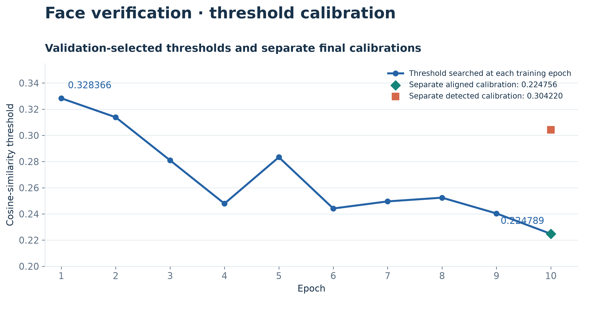
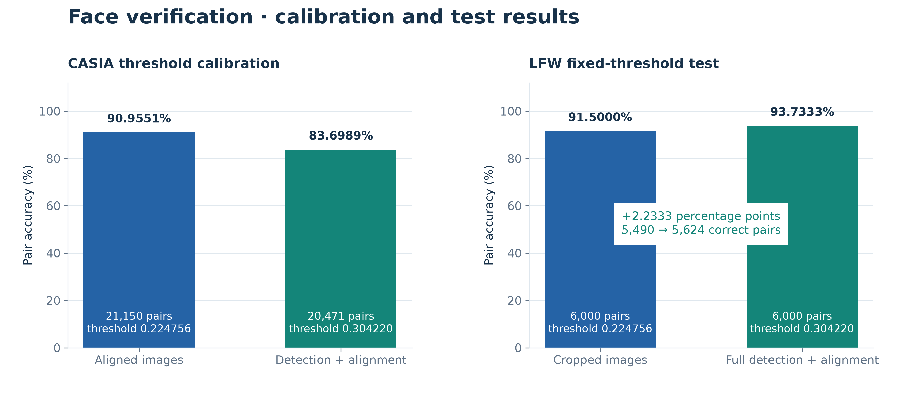
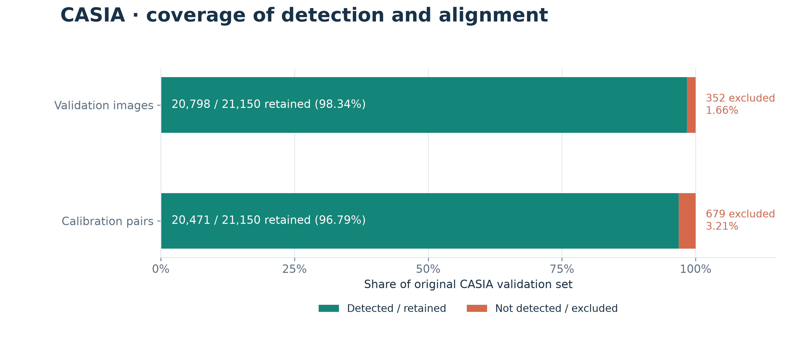

# Assignment 4：人脸验证实验报告

## 1. 实验任务

本实验要求实现判断两张人脸图片是否属于同一个人的验证系统，并提供以下接口：

```python
Y = FaceVerification(X1, X2)
```

`X1`、`X2` 为图片路径；`Y` 为 Python 整数，`1` 表示同一个人，`0` 表示不同的人。系统包含人脸检测、对齐、特征提取及相似度判决模块，并提供命令行与 GUI 界面。

| 数据文件或目录 | 构成 | 实验用途 |
|---|---|---|
| `CASIA-WebFace-Align-96/` | 已对齐的人脸图片，按身份目录组织 | 训练及验证图片来源 |
| `CASIA-WebFace-Align-96/train.txt` | 433041 张图片，10574 个身份 | 更新网络参数 |
| `CASIA-WebFace-Align-96/val.txt` | 21150 张图片，10575 个身份 | 选择模型与相似度阈值 |
| `CASIA-WebFace-Align-96/train_all.txt` | 454191 张图片 | 完整图片清单，是上面两者的并集 |
| `scikit_learn_data/lfw_home/lfw_funeled_cropped/` | LFW 裁剪图片，目录拼写按数据包保留 | 测试特征比较流程 |
| `scikit_learn_data/lfw_home/lfw_funneled/` | LFW 尺寸较大的已对齐源图片 | 测试包含检测、再次对齐的完整流程 |
| `scikit_learn_data/lfw_home/pairs.txt` | 6000 对，同人、异人各 3000 对 | 指定测试配对及真实标签 |

CASIA 清单每行包含图片相对路径与身份标签。读取时保留原标签；训练标签存在空缺，分类头按照最大标签加一设置为 10575 个输出。

验证集按身份标签排序，为每个身份取前两张图片组成同人对，再取该身份第一张与下一个身份第一张组成异人对，最后一个身份与第一个身份配对，共得到 21150 对。LFW 严格读取 `pairs.txt`，6000 对涉及 7701 张去重图片。

实验实现了训练、逐轮验证、阈值标定、固定阈值测试与双图片 GUI。采用已有的 MTCNN、FaceMobileNet 和 CosFace 方法。

实验流程为：**CASIA `train.txt` 训练 → `val.txt` 选择模型与阈值 → LFW `pairs.txt` 固定阈值测试**。本次已在 CUDA 环境完成 10 轮训练，最终使用验证表现最好的 `best.pth` 进行标定与测试。

## 2. 网络结构

### 2.1 检测、对齐与预处理

对于接口和 GUI 输入的图片，首先使用 MTCNN 检测人脸；存在多张人脸时选择面积最大的一张，根据双眼、鼻尖和嘴角共五个关键点进行相似变换对齐。随后转为灰度图，缩放为 `128×128`，将像素转换为张量并使用 `mean=0.5`、`std=0.5` 归一化，得到 `1×128×128` 输入。

MTCNN 的最小人脸尺寸为 20，三级检测阈值为 `(0.6, 0.7, 0.7)`，图像金字塔缩放因子为 `0.709`。CASIA 训练和已对齐图片评估直接读取已有裁剪图，不重复检测。训练预处理额外使用随机水平翻转、缩放至 `144×144` 和随机裁剪至 `128×128`。

### 2.2 FaceMobileNet 特征提取网络

骨干网络实现在 [model/fmobilenet.py](faceRecognitionCASIA/model/fmobilenet.py)，通过逐通道卷积、逐点卷积和残差连接提取 512 维人脸特征。下表省略批次维度，输出尺寸按“通道×高×宽”表示。

| 阶段 | 主要操作 | 输出尺寸 |
|---|---|---|
| 输入 | 灰度、缩放与归一化 | `1×128×128` |
| conv1 | `3×3` 卷积，步长 2，BN、PReLU | `64×64×64` |
| conv2 | `3×3` 逐通道卷积，步长 1，BN | `64×64×64` |
| conv3 | `1×1` 扩展至 128 通道，逐通道卷积步长 2，投影至 64 通道 | `64×32×32` |
| conv4 | 4 个残差块，块内扩展至 128 通道 | `64×32×32` |
| conv5 | 扩展至 256 通道，逐通道卷积步长 2，投影至 128 通道 | `128×16×16` |
| conv6 | 6 个残差块，块内扩展至 256 通道 | `128×16×16` |
| conv7 | 扩展至 512 通道，逐通道卷积步长 2，投影至 128 通道 | `128×8×8` |
| conv8 | 2 个残差块，块内扩展至 256 通道 | `128×8×8` |
| conv9 | `1×1` 卷积，BN、PReLU | `512×8×8` |
| conv10 | `7×7` 逐通道卷积，无填充，BN | `512×2×2` |
| 特征输出 | 展平为 2048 维，线性映射与 BN | `512` |

### 2.3 训练与模型选择

训练阶段在特征网络之后连接 CosFace 分类头。先对特征和类别权重归一化，计算余弦值，再将真实类别的余弦值减去间隔 `m=0.40`，最后乘以尺度 `s=30.0`，以加强身份之间的区分。

默认使用项目中的 FocalLoss，`gamma=2`。当前实现先计算批次平均交叉熵 `L_CE`，再计算 `(1-exp(-L_CE))² × L_CE`，与逐样本加权的标准 Focal Loss 实现有区别。

[config.py](faceRecognitionCASIA/config.py) 中本次实验采用的训练配置如下。按该配置，`restore=False`，骨干网络从随机初始化开始训练，不加载原有 `18.pth`。

| 参数 | 配置值 |
|---|---|
| 骨干网络 / 分类头 | FaceMobileNet / CosFace |
| 特征维度 / 批次大小 | 512 / 64 |
| 训练轮数 / 随机种子 | 10 / 42 |
| 优化器 / 初始学习率 | SGD / 0.1 |
| 权重衰减 | `5e-4` |
| 学习率调度 | StepLR，每 10 轮乘以 0.1 |
| 初始化 / 运行设备 | 随机初始化（`restore=False`）/ CUDA |

学习率调度在每轮结束后执行，因此本次 10 轮参数更新均使用学习率 0.1，第一次衰减发生在第 10 轮结束后。训练集清单包含 433041 张图片，训练加载器设置 `drop_last=True`，每轮执行 6766 个完整批次。

每轮训练仅使用 `train.txt` 更新参数，随后在 `val.txt` 提取特征、计算配对相似度并搜索使验证准确率最高的阈值。按验证配对准确率保存最佳骨干网络为 `best.pth`，同时保存其已对齐图片阈值。

### 2.4 阈值标定与判决

对于两张图片的特征向量 `f1`、`f2`，计算余弦相似度：

```text
similarity = (f1 · f2) / (||f1|| × ||f2||)
Y = 1，若 similarity >= threshold；否则 Y = 0
```

已对齐图片与包含 MTCNN 检测、对齐的输入流程分别在 CASIA 验证集标定阈值，保存到：

- `checkpoints/validation_threshold.json`：用于已对齐图片的特征比较。
- `checkpoints/verification_threshold.json`：用于完整检测流程、接口及 GUI。

阈值文件同时记录权重 SHA-256、网络配置和预处理信息，运行时检查是否匹配。更换权重后需要重新标定；标定会覆盖对应阈值文件。LFW 测试固定使用 CASIA 验证阈值，不利用 LFW 标签重新搜索阈值。

## 3. 安装与运行

### 3.1 环境与数据准备

使用 Python 3.12。从仓库根目录开始，创建 `Assignment_4/.venv` 作为虚拟环境：

```bash
cd Assignment_4
python -m venv .venv
source .venv/bin/activate
python -m pip install -r requirements.txt
cd faceRecognitionCASIA
```

依赖见 [requirements.txt](requirements.txt)。训练与测试使用 CUDA，PyTorch 需与运行环境的 GPU 驱动兼容。后续命令均在 `Assignment_4/faceRecognitionCASIA/` 中执行。
若 `datasets/` 尚未存在，在命令行中执行一次：

```bash
unzip -q datasets.zip
```

解压后应存在第一部分所列的 CASIA 和 LFW 目录。本次实验使用训练生成的 `checkpoints/best.pth`。训练及标定步骤见 3.4；已有该权重但缺少阈值文件时，先执行：

```bash
python calibrate.py --checkpoint best.pth --mode both
```

该命令仅提取 CASIA 验证特征并标定阈值，不更新网络权重。`--mode` 可选择 `aligned`、`detected` 或 `both`，默认 `both`。

### 3.2 接口与命令行

在当前目录的 Python 程序中调用：

```python
from face_verification import FaceVerification

Y = FaceVerification("/absolute/path/face1.jpg", "/absolute/path/face2.jpg")
print(Y)  # 1：同一个人；0：不同的人，或未检测到人脸
```

命令行调用：

```bash
python face_verification.py /absolute/path/face1.jpg /absolute/path/face2.jpg --checkpoint best.pth
```

程序输出 `0` 或 `1`。`--checkpoint` 指定 `checkpoints/` 中的权重文件名。模型和检测器在进程内缓存，重复调用接口时复用。

### 3.3 图形界面

```bash
python gui.py --checkpoint best.pth
```

在两侧分别点击“选择图片”，预览后点击“开始验证”。界面显示同人或异人判断、余弦相似度与阈值；支持更换和清空图片，对无脸、文件损坏及配置错误给出提示。推理在后台线程执行，界面保持响应。GUI 需在桌面环境或启用 WSLg 的 WSL 中运行。这里没有像示例中一样实现视频图片截取，而是直接选取两张照片。



### 3.4 训练、标定与测试

本次从头训练使用上述 `config.py` 配置，保持 `restore=False`。训练完成后，对选出的最佳模型分别标定两种预处理流程的阈值：

```bash
python train.py
python calibrate.py --checkpoint best.pth --mode both
```

训练后新启动的进程默认优先使用 `best.pth`；不存在时使用 `18.pth`。LFW 裁剪图片测试与完整检测流程测试分别运行：

```bash
python test.py --checkpoint best.pth
python test.py --checkpoint best.pth --detect \
  --test-root datasets/scikit_learn_data/lfw_home/lfw_funneled
```

## 4. 测试结果

### 4.1 训练过程与模型选择

本次在 CUDA 环境完成 10 轮训练，训练身份分类头包含 10575 个输出。下表记录各轮平均训练损失、CASIA 验证配对准确率及该轮搜索得到的阈值；“更新最佳模型”表示该轮准确率超过此前最高值。

| 轮次 | 训练损失 | 验证配对准确率 | 余弦阈值 | 更新最佳模型 |
|---|---:|---:|---:|:---:|
| 1 | 16.9737 | 80.7092% | 0.328366 | 是 |
| 2 | 11.8487 | 84.0426% | 0.313884 | 是 |
| 3 | 10.1410 | 87.0827% | 0.280982 | 是 |
| 4 | 9.3723 | 88.9787% | 0.247879 | 是 |
| 5 | 8.9166 | 86.2222% | 0.283335 | 否 |
| 6 | 8.6006 | 90.0946% | 0.244151 | 是 |
| 7 | 8.3561 | 89.7967% | 0.249578 | 否 |
| 8 | 8.1521 | 90.1891% | 0.252410 | 是 |
| 9 | 7.9825 | 90.7801% | 0.240378 | 是 |
| 10 | 7.8468 | **90.9598%** | 0.224789 | 是 |

训练损失由 16.9737 降至 7.8468，验证准确率总体上升，较首轮提高约 10.2506 个百分点。第 5、7 轮验证准确率有所回落，第 10 轮达到本次最高验证准确率。

### 4.2 阈值标定与 LFW 测试

训练完成后，重新加载 `best.pth` 并执行 `calibrate.py --mode both`。下表中的验证阈值均来自独立标定运行，LFW 测试固定使用对应阈值。

| 评估项目 | 准确率 | 余弦阈值 | 参与配对数 |
|---|---:|---:|---:|
| CASIA 已对齐图片阈值标定 | 90.9551% | 0.224756 | 21150 |
| CASIA 检测、对齐流程阈值标定 | 83.6989% | 0.304220 | 20471 |
| LFW 裁剪图片固定阈值测试 | **91.5000%** | 0.224756 | 6000 |
| LFW 完整检测、对齐流程测试 | **93.7333%** | 0.304220 | 6000 |

CASIA 已对齐标定使用全部 21150 对，无检测失败。完整检测流程在 21150 张验证图片中有 352 张未检出人脸，涉及的 679 对从阈值标定中排除，剩余 20471 对参与标定。

LFW 完整流程涉及的 7701 张图片均检出人脸，6000 对全部参与评估。裁剪图片流程正确判断 5490 对，完整检测流程正确判断 5624 对，准确率提高约 2.2333 个百分点。完整流程从尺寸较大的 `lfw_funneled` 图片开始，包含再次检测、对齐，并使用单独标定的阈值。

### 4.3 结果可视化

训练损失持续下降，验证配对准确率总体上升；空心标记表示第 5、7 轮的回落，星形标记表示被选为最佳模型的第 10 轮。验证准确率纵轴从 78% 开始，以便观察逐轮变化。



阈值曲线来自训练中的逐轮验证；第 10 轮位置的菱形和方形点分别表示重新加载 `best.pth` 后，对已对齐流程和完整检测流程进行独立标定的结果。两种流程的阈值分别用于对应的 LFW 固定阈值测试。



以下将 CASIA 阈值标定与 LFW 固定阈值测试分面展示。LFW 完整流程比裁剪图片流程多正确判断 134 对；由于两者的输入图片尺寸、预处理及阈值均不同，不能将差异单独归因于检测器。



CASIA 完整检测流程保留 20798 张验证图片（98.34%）和 20471 对标定配对（96.79%）。一张图片可能参与多个配对，因此图片未检出率与配对排除率不同。

。

## 5. CLI 输出

```bash
((.venv) ) root@zsh945-07vpzopgu17p-main:/openbayes/home/ML2027/Assignment_4/faceRecognition
CASIA# python train.py
Device: cuda, identities: 10575, images: 433041
Epoch 1/10: 100%|██████████████████████████████████████| 6766/6766 [04:31<00:00, 24.93it/s]
Epoch 1/10, loss: 16.9737
Validation pair accuracy: 80.7092%; threshold: 0.328366
Saved best model: /output/ML2027/Assignment_4/faceRecognitionCASIA/checkpoints/best.pth
Epoch 2/10: 100%|██████████████████████████████████████| 6766/6766 [02:44<00:00, 41.12it/s]
Epoch 2/10, loss: 11.8487
Validation pair accuracy: 84.0426%; threshold: 0.313884
Saved best model: /output/ML2027/Assignment_4/faceRecognitionCASIA/checkpoints/best.pth
Epoch 3/10: 100%|██████████████████████████████████████| 6766/6766 [02:44<00:00, 41.09it/s]
Epoch 3/10, loss: 10.1410
Validation pair accuracy: 87.0827%; threshold: 0.280982
Saved best model: /output/ML2027/Assignment_4/faceRecognitionCASIA/checkpoints/best.pth
Epoch 4/10: 100%|██████████████████████████████████████| 6766/6766 [02:48<00:00, 40.19it/s]
Epoch 4/10, loss: 9.3723
Validation pair accuracy: 88.9787%; threshold: 0.247879
Saved best model: /output/ML2027/Assignment_4/faceRecognitionCASIA/checkpoints/best.pth
Epoch 5/10: 100%|██████████████████████████████████████| 6766/6766 [02:41<00:00, 41.84it/s]
Epoch 5/10, loss: 8.9166
Validation pair accuracy: 86.2222%; threshold: 0.283335
Epoch 6/10: 100%|██████████████████████████████████████| 6766/6766 [02:43<00:00, 41.43it/s]
Epoch 6/10, loss: 8.6006
Validation pair accuracy: 90.0946%; threshold: 0.244151
Saved best model: /output/ML2027/Assignment_4/faceRecognitionCASIA/checkpoints/best.pth
Epoch 7/10: 100%|██████████████████████████████████████| 6766/6766 [02:41<00:00, 41.77it/s]
Epoch 7/10, loss: 8.3561
Validation pair accuracy: 89.7967%; threshold: 0.249578
Epoch 8/10: 100%|██████████████████████████████████████| 6766/6766 [02:40<00:00, 42.12it/s]
Epoch 8/10, loss: 8.1521
Validation pair accuracy: 90.1891%; threshold: 0.252410
Saved best model: /output/ML2027/Assignment_4/faceRecognitionCASIA/checkpoints/best.pth
Epoch 9/10: 100%|██████████████████████████████████████| 6766/6766 [02:42<00:00, 41.75it/s]
Epoch 9/10, loss: 7.9825
Validation pair accuracy: 90.7801%; threshold: 0.240378
Saved best model: /output/ML2027/Assignment_4/faceRecognitionCASIA/checkpoints/best.pth
Epoch 10/10: 100%|█████████████████████████████████████| 6766/6766 [02:49<00:00, 39.96it/s]
Epoch 10/10, loss: 7.8468
Validation pair accuracy: 90.9598%; threshold: 0.224789
Saved best model: /output/ML2027/Assignment_4/faceRecognitionCASIA/checkpoints/best.pth
```
